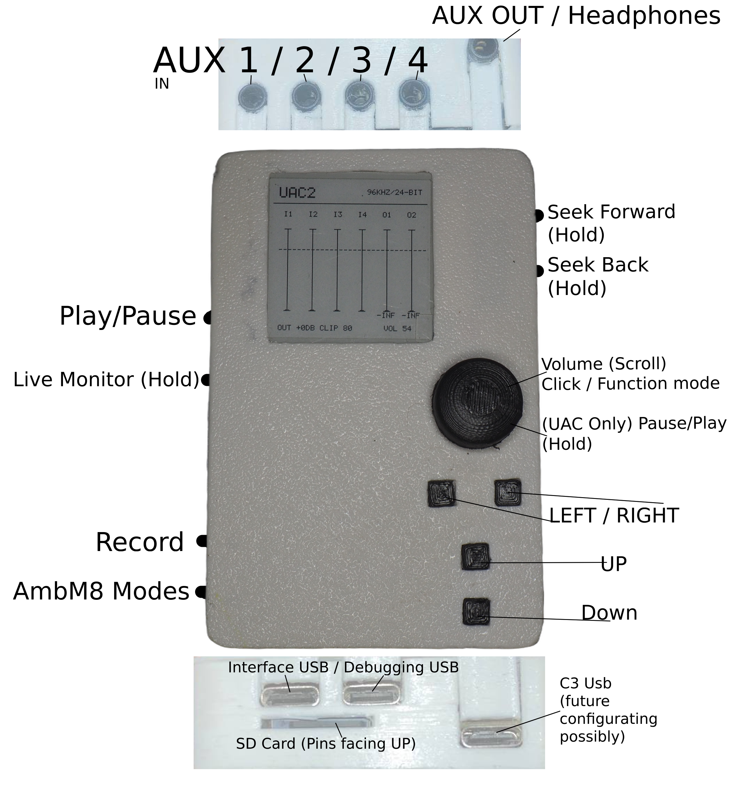

# Controls

---

# Modes

AmbM8 runs in 1 of **3 modes**, chosen at boot and switched with the "Modes" key:

| # | Mode | What it does |
|---|---|---|
| 0 | **UAC2 Audio** | audio interface (4-ch in, 2-ch out) |
| 1 | **SD Storage (MSC)** | Inserted SD card shows up as mass storage on host |
| 2 | **Standalone** | Recorder / player running from SD |

- UAC2 / Standalone is automatically switched

---
---

# Standalone

### Side Keys left

| Key  | Action |
|----|--|
| Top - Left 1 | Play / Pause |
| Top - Left 2 | Hold will Toggle Live Monitor |
| Bottom - Left 1 | Rec - Start / Stop |
|  Bottom - Left 2 | Hold will cycle USB Modes |

+ If MSC has not been unmointed, Pressing Modes will  blink a LED reminding to unmount first.

### Side Keys right

| Key | Action |
|-----|---|
|  Top - Right 1 | hold during playback: seek forward |
|  Top - Right 2 | hold during playback: seek back |

### Front Keys

| Key | Primary Action |
|----|----|
|  Up |  Menu up |
|  Down |  Menu down |
|  Left | Hold to go Back / Exit (in Settings/Playback) |
| Right | Hold to Enter / Select (in Settings/Playback) |

### Encoder

| Action | Function |
|----|----|
| Turn | Volume +/- (most menus)  /  Gain adjust (click encoder)  /  Spectrum sensitivity (EQ menu, hold) |
| Click | Toggle individual-gain-pick mode (cycles In1-4 / Out1-2) only in Home menu |
| Double-click | Exit individual-gain-pick mode |
| Hold (0.5 s) | Reset selected gain to 0 dB (outside Settings) / Back (inside Settings) |

---
---

# UAC2

### Media controls

| Key  | Primary Action |
|----|----|
| Top - Right 1 | Next |
| Top - Right 2 | Previous |
|  Bottom - Left 2 | Hold will cycle MSC |

### Encoder

| Action | Function |
|----|---|
| Turn Left | - Volume |
| Turn Right | + Volume |
| Encoder Press | Pause / Unpause Media |

---

### LED Indicators

| LED Location | Purpose |
|--|-----|
| Lower Middle | UI status / activity |
| Bottom left of device | Red LED while recording & orange LED when mic clipping |
| Under Lower Middle | Red led showing power |

---
