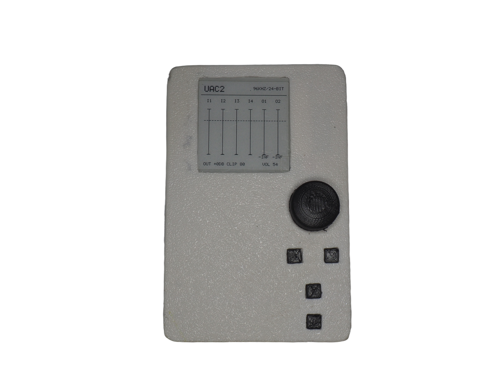
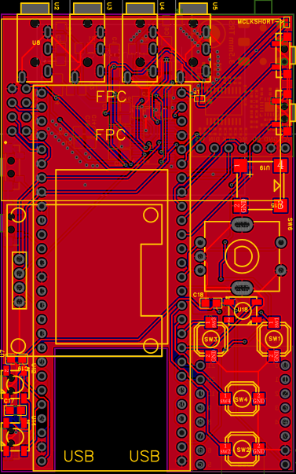
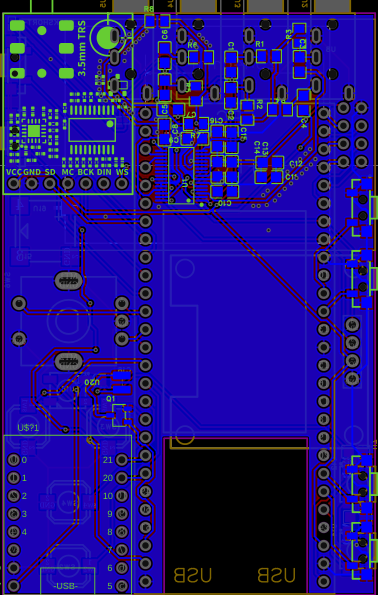
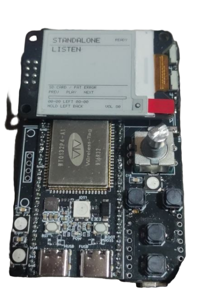
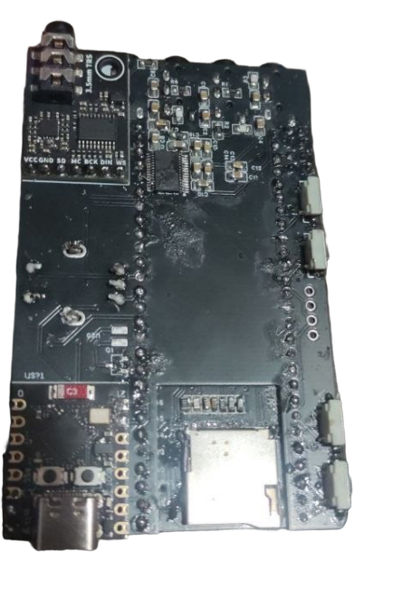
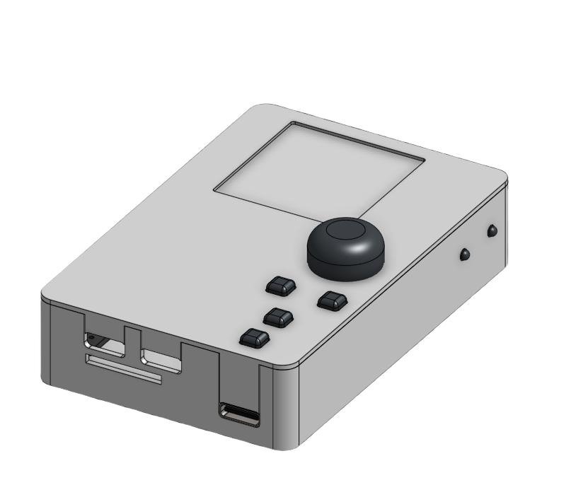

# AmbM8

**AmbM8** (short for *Ambisonic Mate*) is a budget-ish (about £40 in parts) 4-in / 2-out audio interface built around the ESP32-P4 and the PCM1865. It works as a proper USB interface with a computer, as a mass-storage card reader, and entirely standalone as a recorder / player with its intuitive(ish) E-Paper UI.

[YouTube Video](https://www.youtube.com/watch?v=Uah8clTc53E)
---

## Overview

- **USB audio (UAC2)**: 4-ch capture to host over high-speed USB, stereo playback for headphones.
- **Standalone recording**: **24-bit** WAV to SD: **4-ch@48kHz** or **2-ch@192kHz**, with optional WXYZ encoding.
- **Standalone playback**: file browser + player from SD, with APO-format EQ.
- **Live monitor**: ambisonic (A-format) to binaural decoding
- **USB mass storage (MSC)**: Switch to SD mode to download the files from the Device.
- **UI**: 1.54" E-INK display with intuitive(ish) controls

## Hardware:

| | |
|---|---|
|  |  |

| | |
|---|---|
|  |  |

### Why?

Look up the price of a 4-channel USB interface... Go on... want with similar specs...? £222 ? Works for you? No...?

For about £40. If you can make it, it is the cheapest thing in it's class by a lot.

---

## Documentation

[Docs/Controls.md](Docs/Controls.md)

[Hardware/SCH_Schematic_2026-11-04.pdf](Hardware/SCH_Schematic_2026-11-04.pdf) 

[Docs/Pinouts.txt](Docs/Pinouts.txt)

+ Look in `/Hardware` to find Gerbers & Case files.
+ Look in `/Docs` to find all relitive Docs of all ICs / Modules used.

